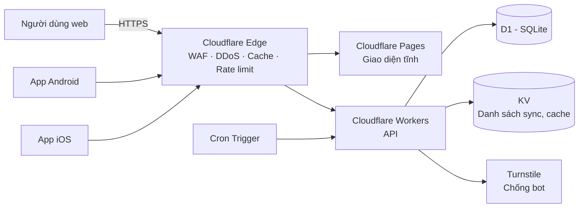

# ARCHITECTURE — Khiên Việt (khienviet.net)

## 1. Tổng quan

Website: `https://khienviet.net` · API: `https://khienviet.net/api/v1/` · Liên hệ: `lienhe@khienviet.net`

Toàn bộ backend chạy trên Cloudflare, **không có server gốc**, vì vậy không có IP nào để lộ hay bị DDoS trực tiếp.



| Thành phần | Công nghệ | Vai trò |
|---|---|---|
| Web | Cloudflare Pages + Astro (hoặc HTML/JS thuần) | Trang tra cứu, báo cáo, thống kê, khiếu nại |
| API | Cloudflare Workers (TypeScript, Hono) | Tra cứu, nhận báo cáo, sync danh sách |
| CSDL | Cloudflare D1 | Báo cáo, thống kê theo số, khiếu nại |
| Cache / sync | Cloudflare KV | Danh sách số nguy cơ cao cho app, cache tra cứu nóng |
| Chống bot | Turnstile + Rate Limiting binding | Bảo vệ endpoint ghi |
| Tác vụ định kỳ | Cron Triggers | Tính lại điểm theo thời gian, xuất danh sách sync |
| Android | Kotlin, `CallScreeningService` | Cảnh báo cuộc gọi đến, báo cáo sau cuộc gọi |
| iOS | Swift, Call Directory Extension | Gắn nhãn / chặn từ danh sách offline |

## 2. Chuẩn hóa số điện thoại

- Lưu dạng **E.164**: `+84xxxxxxxxx`.
- Đầu vào chấp nhận `0912345678`, `84912345678`, `+84 912 345 678`, có dấu chấm, cách hoặc gạch.
- Từ chối số không hợp lệ (độ dài sai, đầu số không tồn tại). Hỗ trợ cả số cố định và số quốc tế (đánh dấu `is_foreign`).
- Hàm chuẩn hóa dùng chung giữa web, Worker và app, có unit test đầy đủ.

## 3. Mô hình dữ liệu (D1)

```sql
-- Mỗi người báo cáo được nhận diện bằng token ẩn danh, không lưu thông tin cá nhân.
CREATE TABLE reporters (
  id            TEXT PRIMARY KEY,          -- UUID
  token_hash    TEXT NOT NULL UNIQUE,      -- SHA-256(device/install token + pepper)
  trust_score   REAL NOT NULL DEFAULT 1.0, -- 0.1 .. 3.0
  report_count  INTEGER NOT NULL DEFAULT 0,
  created_at    INTEGER NOT NULL,
  banned        INTEGER NOT NULL DEFAULT 0
);

-- Mỗi dòng là một cuộc gọi được ghi nhận.
CREATE TABLE reports (
  id            TEXT PRIMARY KEY,
  phone         TEXT NOT NULL,             -- E.164
  reporter_id   TEXT NOT NULL REFERENCES reporters(id),
  label         TEXT NOT NULL CHECK (label IN ('scam','spam','safe','unknown')),
  scenario      TEXT,                      -- 'fake_police','fake_shipper','investment','loan','prize',...
  note          TEXT,                      -- tối đa 280 ký tự, lọc PII
  source        TEXT NOT NULL,             -- 'web','android','ios','seed'
  called_at     INTEGER,                   -- thời điểm cuộc gọi (nếu có)
  created_at    INTEGER NOT NULL,
  status        TEXT NOT NULL DEFAULT 'active' CHECK (status IN ('active','hidden','removed'))
);
CREATE INDEX idx_reports_phone ON reports(phone, created_at);
CREATE INDEX idx_reports_reporter ON reports(reporter_id, created_at);

-- Một người chỉ được tính 1 phiếu cho mỗi số trong mỗi 24h.
CREATE UNIQUE INDEX uq_reports_dedupe
  ON reports(phone, reporter_id, label, created_at / 86400);

-- Bảng tổng hợp, cập nhật khi ghi báo cáo và tính lại bởi cron.
CREATE TABLE phone_stats (
  phone              TEXT PRIMARY KEY,
  total_reports      INTEGER NOT NULL DEFAULT 0,   -- số cuộc gọi được ghi nhận
  scam_reports       INTEGER NOT NULL DEFAULT 0,
  spam_reports       INTEGER NOT NULL DEFAULT 0,
  safe_reports       INTEGER NOT NULL DEFAULT 0,
  unique_reporters   INTEGER NOT NULL DEFAULT 0,
  unique_scam_reporters INTEGER NOT NULL DEFAULT 0,
  score              REAL NOT NULL DEFAULT 0,
  risk_level         TEXT NOT NULL DEFAULT 'insufficient', -- insufficient|low|medium|high
  top_scenarios      TEXT,                          -- JSON
  first_reported_at  INTEGER,
  last_reported_at   INTEGER,
  under_review       INTEGER NOT NULL DEFAULT 0     -- đang có khiếu nại
);
CREATE INDEX idx_stats_risk ON phone_stats(risk_level, last_reported_at);

-- Khiếu nại từ chủ thuê bao.
CREATE TABLE disputes (
  id           TEXT PRIMARY KEY,
  phone        TEXT NOT NULL,
  contact      TEXT NOT NULL,     -- mã hóa khi lưu, xóa sau khi xử lý xong
  reason       TEXT NOT NULL,
  status       TEXT NOT NULL DEFAULT 'open' CHECK (status IN ('open','accepted','rejected')),
  created_at   INTEGER NOT NULL,
  resolved_at  INTEGER
);
```

## 4. Thuật toán điểm nguy cơ (công khai)

Với mỗi báo cáo đang `active` của một số:

```
w_time   = 0.5 ^ (tuổi_báo_cáo_ngày / 30)        // half-life 30 ngày
w_trust  = reporters.trust_score                 // 0.1 .. 3.0
v_label  = scam: +1.0 | spam: +0.3 | safe: -1.0 | unknown: 0

score    = Σ (w_time × w_trust × v_label)        // mỗi reporter chỉ tính báo cáo mới nhất của họ cho số đó
scam_ratio = unique_scam_reporters / unique_reporters
```

Phân loại mức nguy cơ:

| Mức | Điều kiện |
|---|---|
| `insufficient` | `unique_reporters < 3` |
| `low` | `score < 1.5` hoặc `scam_ratio < 0.3` |
| `medium` | `score >= 1.5` và `scam_ratio >= 0.3` |
| `high` | `score >= 4` và `scam_ratio >= 0.7` và `unique_scam_reporters >= 5` |

Nếu `under_review = 1`, không hiển thị `high` mà hiển thị "Đang xem xét khiếu nại" kèm số liệu thô.

Các ngưỡng là tham số cấu hình (`wrangler.toml` vars) và sẽ được hiệu chỉnh khi có dữ liệu thật.

**Uy tín người báo cáo:** khởi đầu 1.0. Tăng dần khi báo cáo của họ trùng với kết luận của số đông sau 14 ngày; giảm khi lệch nhiều lần; đặt 0.1 nếu phát hiện hành vi bất thường.

## 5. API (Workers)

Tất cả trả về JSON. Endpoint ghi yêu cầu Turnstile token (web) hoặc install token đã đăng ký (app).

| Method | Path | Mô tả | Cache |
|---|---|---|---|
| GET | `/api/v1/lookup/:phone` | Tra cứu một số (số liệu, mức nguy cơ, kịch bản) | Edge 120s |
| POST | `/api/v1/reports` | Gửi báo cáo `{phone, label, scenario?, note?, called_at?}` | — |
| GET | `/api/v1/stats/summary` | Thống kê tổng (tổng báo cáo, số nguy cơ cao, xu hướng) | Edge 10 phút |
| GET | `/api/v1/stats/top?period=7d` | Danh sách số bị báo nhiều nhất (**số đã che một phần**) | Edge 10 phút |
| GET | `/api/v1/sync/blocklist?since=` | Danh sách số `high`/`medium` cho app, có phân trang và delta | KV, 1 giờ |
| POST | `/api/v1/install` | App đăng ký install token (ẩn danh) | — |
| POST | `/api/v1/disputes` | Gửi khiếu nại | — |

Ví dụ response tra cứu:

```json
{
  "phone": "+84912345678",
  "risk_level": "high",
  "total_reports": 128,
  "scam_reports": 117,
  "unique_reporters": 96,
  "top_scenarios": [{"key": "fake_police", "count": 71}, {"key": "investment", "count": 22}],
  "first_reported_at": "2026-10-01T03:12:00Z",
  "last_reported_at": "2026-11-05T09:40:00Z",
  "under_review": false
}
```

## 6. Chống lạm dụng

- **Turnstile** trên mọi form web; **Rate Limiting binding**: ví dụ 10 báo cáo/giờ/reporter, 30 báo cáo/giờ/IP.
- **Dedupe:** 1 phiếu/số/reporter/24h. Khi tính điểm, mỗi reporter chỉ tính phiếu mới nhất cho một số.
- **Phát hiện bất thường (cron):** nhiều reporter mới cùng gắn `safe` cho một số trong thời gian ngắn; một reporter báo hàng loạt số liên tiếp; nhiều báo cáo từ cùng ASN hoặc IP. Khi phát hiện, báo cáo bị đặt `hidden` và trust score bị hạ.
- **Android:** chỉ cho báo cáo nhanh số vừa gọi đến (nhận biết qua `CallScreeningService`); báo cáo từ nguồn này có trọng số khởi đầu cao hơn.
- **Lọc note:** bỏ số điện thoại, email, số tài khoản trong ghi chú; giới hạn độ dài.

## 7. Quyền riêng tư

- Không thu thập danh bạ, lịch sử cuộc gọi, vị trí hay số điện thoại của người báo cáo.
- Install token được hash kèm pepper (Worker secret) trước khi lưu.
- **Không lưu IP** vào D1; chỉ dùng tạm thời trong bộ nhớ để rate limit.
- Danh sách công khai che số: `+84 91x xxx 678`. Chỉ hiện đủ khi người dùng tra cứu đúng số đó.
- Thông tin liên hệ trong khiếu nại được mã hóa và xóa sau khi xử lý.
- Log của Worker không chứa số điện thoại thô của người báo cáo hay token.

## 8. App di động

**Android (Kotlin):**
- `CallScreeningService` tra cứu cục bộ (Room DB đồng bộ từ `/sync/blocklist`), sau đó tra online với timeout 1 giây.
- Hiện overlay hoặc thông báo mức nguy cơ; tùy chọn tự động từ chối cuộc gọi `high`.
- Sau cuộc gọi từ số không có trong danh bạ, hiện thông báo báo cáo nhanh với các nút nhãn.
- WorkManager đồng bộ danh sách mỗi 6 giờ.

**iOS (Swift):**
- Call Directory Extension nạp danh sách (sắp xếp tăng dần theo số) với nhãn "⚠️ Nguy cơ lừa đảo (N báo cáo)".
- Background refresh gọi `CXCallDirectoryManager.reloadExtension`.
- Báo cáo qua màn hình dán số, Share Extension hoặc App Intent cho Shortcuts.

## 9. Bảo mật vận hành

- Không có server gốc; mọi tài nguyên nằm trong một tài khoản Cloudflare riêng của dự án, bảo vệ bằng 2FA khóa bảo mật.
- Secrets (`PEPPER`, `TURNSTILE_SECRET`, khóa mã hóa) lưu bằng `wrangler secret`, không commit.
- Bật WAF managed rules, Bot Fight Mode, và "Under Attack Mode" khi cần.
- Sao lưu D1 định kỳ (`wrangler d1 export`) vào R2 có mã hóa.
- Commit dùng email noreply; không đưa thông tin cá nhân vào repo, issue hay ảnh chụp.

## 10. Cấu trúc repo

```
/
├── apps/
│   ├── web/              # Cloudflare Pages (Astro)
│   ├── android/          # Kotlin
│   └── ios/              # Swift
├── workers/
│   └── api/              # Hono + D1 + KV
│       ├── src/
│       ├── migrations/   # SQL migrations D1
│       └── wrangler.toml
├── packages/
│   └── phone/            # Chuẩn hóa số + test (TS), port sang Kotlin/Swift
├── docs/
│   ├── PLAN.md
│   └── ARCHITECTURE.md
└── CLAUDE.md
```

## 11. Giới hạn đã biết

- D1 phù hợp với quy mô vừa. Nếu lượng ghi tăng mạnh, cân nhắc tách bảng `reports` theo thời gian hoặc chuyển sang Postgres (Neon/Supabase) qua Hyperdrive.
- iOS không thể tra cứu theo thời gian thực khi có cuộc gọi đến; chỉ dùng được danh sách offline.
- Số liệu "cuộc gọi đã ghi nhận" chỉ phản ánh các cuộc được cộng đồng báo cáo, không phải tổng số cuộc gọi thực tế. Giao diện phải nói rõ điều này.
