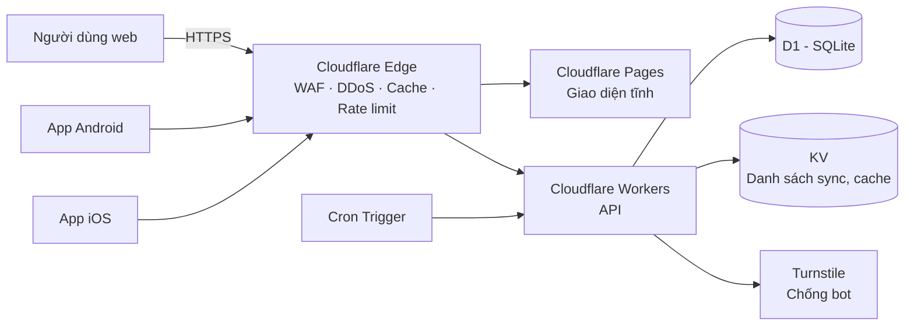

# ARCHITECTURE — Khiên Việt (khienviet.net)

## 1. Tổng quan

Website: `https://khienviet.net` · API: `https://khienviet.net/api/v1/` · Liên hệ: `lienhe@khienviet.net`

Toàn bộ backend chạy trên Cloudflare, **không có server gốc**, vì vậy không có IP nào để lộ hay bị DDoS trực tiếp.



| Thành phần | Công nghệ | Vai trò |
|---|---|---|
| Web | Cloudflare Pages + Astro (hoặc HTML/JS thuần) | Trang tra cứu, báo cáo, thống kê, khiếu nại |
| API | Cloudflare Workers (TypeScript, Hono) | Tra cứu, nhận báo cáo, sync danh sách |
| CSDL | Cloudflare D1 | Báo cáo, thống kê theo số, khiếu nại |
| Cache / sync | Cloudflare KV | Danh sách số nguy cơ cao cho app, cache tra cứu nóng |
| Chống bot | Turnstile + Rate Limiting binding | Bảo vệ endpoint ghi |
| Tác vụ định kỳ | Cron Triggers | Tính lại điểm theo thời gian, xuất danh sách sync |
| Android | Kotlin, `CallScreeningService` | Cảnh báo cuộc gọi đến, báo cáo sau cuộc gọi |
| iOS | Swift, Call Directory Extension | Gắn nhãn / chặn từ danh sách offline |

## 2. Chuẩn hóa số điện thoại

- Lưu dạng **E.164**: `+84xxxxxxxxx`.
- Đầu vào chấp nhận `0912345678`, `84912345678`, `+84 912 345 678`, có dấu chấm, cách hoặc gạch.
- **Kiểm tra lỏng theo chữ số đầu và độ dài**, không theo danh sách đầu số của từng nhà mạng:
  - Di động: 9 chữ số sau `+84`, bắt đầu bằng `3`, `5`, `7`, `8`, `9` (tức `03x`, `05x`, `07x`, `08x`, `09x` khi viết với số 0).
  - Cố định: 10 chữ số sau `+84`, bắt đầu bằng `2` (tức `02x...`).
  - Số quốc tế: `+` hoặc `00` + mã nước khác 84, tổng 8–15 chữ số (đánh dấu `is_foreign`).
  - Từ chối: sai độ dài, sai chữ số đầu, ký tự lạ, đầu số dịch vụ (`1900`, `1800`), số ngắn.
- **Lý do không dùng danh sách đầu số:** danh sách thay đổi theo thời gian (nhà mạng được cấp đầu số mới). Nếu từ chối nhầm một số thật, người dùng không báo cáo được và app không cảnh báo được, cho đến khi cả API lẫn app được cập nhật. Đổi lại, kiểm tra lỏng có thể nhận một số không tồn tại; hậu quả nhỏ vì số dưới ngưỡng `unique_reporters` hiển thị `insufficient`.
- **Bù lại bằng cron:** định kỳ liệt kê các số được báo cáo có đầu số bất thường để người vận hành xem xét (không tự động xóa).
- Hàm chuẩn hóa dùng chung giữa web, Worker và app. Bản TS (`packages/phone`) là chuẩn; mọi bản port phải chạy cùng bộ test `packages/phone/test/vectors.json`.

## 3. Mô hình dữ liệu (D1)

Nguồn chuẩn là các migration trong `workers/api/migrations/`; khối dưới đây phải khớp với chúng. Hiện tại: `0001_init.sql`.

```sql
-- Schema ban đầu. Xem docs/ARCHITECTURE.md mục 3. Không sửa file này sau khi đã áp dụng.

-- Mỗi người báo cáo được nhận diện bằng install token ẩn danh, không lưu thông tin cá nhân.
CREATE TABLE reporters (
  id            TEXT PRIMARY KEY,              -- UUID
  token_hash    TEXT NOT NULL UNIQUE,          -- HMAC-SHA256(PEPPER, install token), hex
  trust_score   REAL NOT NULL DEFAULT 1.0,     -- 0.1 .. 3.0
  report_count  INTEGER NOT NULL DEFAULT 0,
  created_at    INTEGER NOT NULL,
  banned        INTEGER NOT NULL DEFAULT 0
);

-- Mỗi dòng là một cuộc gọi được ghi nhận.
CREATE TABLE reports (
  id            TEXT PRIMARY KEY,
  phone         TEXT NOT NULL,                 -- E.164
  reporter_id   TEXT NOT NULL REFERENCES reporters(id),
  label         TEXT NOT NULL CHECK (label IN ('scam','spam','safe','unknown')),
  scenario      TEXT,
  note          TEXT,                          -- tối đa 280 ký tự, đã lọc PII
  source        TEXT NOT NULL CHECK (source IN ('web','android','ios','seed')),
  called_at     INTEGER,
  created_at    INTEGER NOT NULL,
  status        TEXT NOT NULL DEFAULT 'active' CHECK (status IN ('active','hidden','removed'))
);
CREATE INDEX idx_reports_phone ON reports(phone, created_at);
CREATE INDEX idx_reports_reporter ON reports(reporter_id, created_at);

-- Một reporter chỉ được 1 phiếu cùng nhãn cho mỗi số trong mỗi ngày (UTC).
CREATE UNIQUE INDEX uq_reports_dedupe
  ON reports(phone, reporter_id, label, created_at / 86400);

-- Bảng tổng hợp, tính lại khi có báo cáo mới và bởi cron.
CREATE TABLE phone_stats (
  phone                 TEXT PRIMARY KEY,
  total_reports         INTEGER NOT NULL DEFAULT 0,
  scam_reports          INTEGER NOT NULL DEFAULT 0,
  spam_reports          INTEGER NOT NULL DEFAULT 0,
  safe_reports          INTEGER NOT NULL DEFAULT 0,
  unique_reporters      INTEGER NOT NULL DEFAULT 0,
  unique_scam_reporters INTEGER NOT NULL DEFAULT 0,
  score                 REAL NOT NULL DEFAULT 0,
  risk_level            TEXT NOT NULL DEFAULT 'insufficient'
                        CHECK (risk_level IN ('insufficient','low','medium','high')),
  top_scenarios         TEXT,                  -- JSON
  first_reported_at     INTEGER,
  last_reported_at      INTEGER,
  under_review          INTEGER NOT NULL DEFAULT 0,
  updated_at            INTEGER NOT NULL DEFAULT 0  -- đổi khi risk_level hoặc unique_scam_reporters đổi; dùng cho sync delta
);
CREATE INDEX idx_stats_risk ON phone_stats(risk_level, last_reported_at);
CREATE INDEX idx_stats_updated ON phone_stats(updated_at, phone);

-- Khiếu nại từ chủ thuê bao.
CREATE TABLE disputes (
  id           TEXT PRIMARY KEY,
  phone        TEXT NOT NULL,
  contact      TEXT NOT NULL,                  -- mã hóa khi lưu, xóa sau khi xử lý xong
  reason       TEXT NOT NULL,
  status       TEXT NOT NULL DEFAULT 'open' CHECK (status IN ('open','accepted','rejected')),
  created_at   INTEGER NOT NULL,
  resolved_at  INTEGER
);
```

Ghi chú:
- `token_hash` là HMAC-SHA256 với khóa `PEPPER` (Worker secret), không phải SHA-256 của chuỗi ghép: HMAC là cách chuẩn để dùng một khóa bí mật khi băm.
- `phone_stats.updated_at` chỉ đổi khi `risk_level` hoặc `unique_scam_reporters` đổi, để app đồng bộ delta mà không tải lại các số không thay đổi.

## 4. Thuật toán điểm nguy cơ (công khai)

Với mỗi báo cáo đang `active` của một số:

```
w_time   = 0.5 ^ (tuổi_báo_cáo_ngày / 30)        // half-life 30 ngày
w_trust  = reporters.trust_score                 // 0.1 .. 3.0
v_label  = scam: +1.0 | spam: +0.3 | safe: -1.0 | unknown: 0

score    = Σ (w_time × w_trust × v_label)        // mỗi reporter chỉ tính báo cáo mới nhất của họ cho số đó
scam_ratio = unique_scam_reporters / unique_reporters
```

Phân loại mức nguy cơ:

| Mức | Điều kiện |
|---|---|
| `insufficient` | `unique_reporters < 3` |
| `low` | `score < 1.5` hoặc `scam_ratio < 0.3` |
| `medium` | `score >= 1.5` và `scam_ratio >= 0.3` |
| `high` | `score >= 4` và `scam_ratio >= 0.7` và `unique_scam_reporters >= 5` |

**Phiếu nào được tính:** chỉ báo cáo `active` của reporter chưa bị cấm (`banned = 0`). Mỗi reporter chỉ tính phiếu mới nhất cho một số (theo `created_at`, nếu trùng giây thì theo thứ tự ghi). Các số đếm thô (`total_reports`, `scam_reports`...) đếm mọi báo cáo `active` của reporter chưa bị cấm. Phiếu có thời điểm ở tương lai (lệch đồng hồ) được tính như phiếu mới, không nặng hơn.

Nếu `under_review = 1`, mức `high` bị hạ thành `medium`: giao diện hiển thị "Đang xem xét khiếu nại" kèm số liệu thô, và app không tự động chặn số đó (chỉ chặn `high`).

**Điểm yếu đã biết:** `scam_ratio` đếm người báo, không theo trọng số uy tín. Vì vậy nhiều tài khoản đã bị hạ trust 0.1 cùng báo `safe` vẫn kéo tỷ lệ xuống: ví dụ 6 người báo lừa đảo + 20 tài khoản trust 0.1 báo an toàn cho `score` = 4 nhưng `scam_ratio` = 0.23, nên mức là `low`. Test `scoring.test.ts` ghi lại hành vi này. Phương án đang cân nhắc: tính `scam_ratio` theo trọng số `w_time × w_trust`.

Các ngưỡng là tham số cấu hình (`wrangler.toml` vars) và sẽ được hiệu chỉnh khi có dữ liệu thật.

**Uy tín người báo cáo:** khởi đầu 1.0. Tăng dần khi báo cáo của họ trùng với kết luận của số đông sau 14 ngày; giảm khi lệch nhiều lần; đặt 0.1 nếu phát hiện hành vi bất thường.

## 5. API (Workers)

Base: `/api/v1`. Response thành công `{ "data": ... }`, lỗi `{ "error": { "code", "message" } }`. Thời gian trả về dạng ISO 8601 UTC.
Endpoint ghi của app yêu cầu `Authorization: Bearer <install token>`; endpoint ghi của web sẽ dùng Turnstile (chưa làm).

| Method | Path | Xác thực | Mô tả | Trạng thái |
|---|---|---|---|---|
| POST | `/install` | rate limit theo IP | Tạo install token ẩn danh, trả về **một lần**: `{data:{token}}` | ✅ |
| POST | `/reports` | install token | Gửi báo cáo `{phone, label, source, scenario?, note?, called_at?}` | ✅ |
| GET | `/lookup/:phone` | — (rate limit theo IP) | Tra cứu một số. `Cache-Control: public, max-age=120` | ✅ |
| GET | `/sync/blocklist?since=&cursor=&limit=` | install token | Danh sách cho app, phân trang và delta | ✅ |
| GET | `/stats/summary` | — | Thống kê tổng | chưa làm |
| GET | `/stats/top?period=7d` | — | Số bị báo nhiều nhất (**số đã che một phần**) | chưa làm |
| POST | `/disputes` | Turnstile | Gửi khiếu nại | chưa làm |

**`POST /reports`:**
- `label`: `scam` | `spam` | `safe` | `unknown`. `source`: `android` | `ios`.
- `scenario` (tùy chọn): `fake_police`, `fake_bank`, `fake_telecom`, `fake_shipper`, `investment`, `loan`, `prize`, `job_offer`, `other`.
- `note` (tùy chọn): qua `sanitizeNote()` trước khi lưu (mục 6).
- `called_at` (tùy chọn): ISO 8601, không quá 30 ngày trước và không ở tương lai (cho lệch 5 phút).
- Trả `201 {data:{accepted:true,id}}`; trùng (cùng reporter, số, nhãn, ngày UTC) trả `200 {data:{accepted:false,reason:"duplicate"}}`.
- Lỗi: `400 invalid_json | invalid_request | invalid_phone | invalid_called_at`, `401 unauthorized`, `403 forbidden` (reporter bị cấm), `429 rate_limited`.

**`GET /sync/blocklist`:**
- Không có `since`: mọi số `medium`/`high`.
- Có `since` (Unix giây): mọi số có `updated_at >= since`, **kể cả số đã xuống `low`/`insufficient`**, để app xóa khỏi danh sách trên máy.
- `limit` 1–1000 (mặc định 1000); trang tiếp theo dùng `next_cursor` (null khi hết).
- App lưu `server_time` của trang đầu tiên làm `since` cho lần đồng bộ sau.
- Phần tử: `{phone, risk_level, unique_scam_reporters, under_review}`.

Ví dụ response tra cứu (số và số liệu là **minh họa**: không dùng số điện thoại có thể có thật trong tài liệu, nhất là kèm nhãn nguy cơ):

```json
{
  "data": {
    "phone": "+849XXXXXXXX",
    "is_foreign": false,
    "risk_level": "high",
    "total_reports": 128,
    "scam_reports": 117,
    "spam_reports": 4,
    "safe_reports": 2,
    "unique_reporters": 96,
    "unique_scam_reporters": 90,
    "top_scenarios": [{"key": "fake_police", "count": 71}, {"key": "investment", "count": 22}],
    "first_reported_at": "2026-10-01T03:12:00Z",
    "last_reported_at": "2026-11-05T09:40:00Z",
    "under_review": false
  }
}
```

## 6. Chống lạm dụng

- **Turnstile** trên mọi form web (chưa làm).
- **Rate limit:** Rate Limiting binding của Cloudflare chỉ hỗ trợ cửa sổ 10 hoặc 60 giây, đếm gần đúng theo từng vị trí. Vì vậy:
  - Theo IP (binding, mỗi 60 giây): `/install` 5, `/reports` 20, `/lookup` 120. IP chỉ dùng trong bộ nhớ làm khóa, không lưu.
  - Theo reporter (đếm trong D1, chính xác): `REPORTS_PER_HOUR_PER_REPORTER` = 10 báo cáo/giờ.
- **Dedupe:** 1 phiếu/số/reporter/24h. Khi tính điểm, mỗi reporter chỉ tính phiếu mới nhất cho một số.
- **Phát hiện bất thường (cron):** nhiều reporter mới cùng gắn `safe` cho một số trong thời gian ngắn; một reporter báo hàng loạt số liên tiếp; nhiều báo cáo từ cùng ASN hoặc IP. Khi phát hiện, báo cáo bị đặt `hidden` và trust score bị hạ.
- **Android:** chỉ cho báo cáo nhanh số vừa gọi đến (nhận biết qua `CallScreeningService`); báo cáo từ nguồn này có trọng số khởi đầu cao hơn.
- **Lọc note (`sanitizeNote()`):** bỏ ký tự điều khiển và vô hình; thay email và mọi dãy từ 6 chữ số trở lên (cho phép dấu cách/chấm/phẩy/gạch xen giữa) bằng `[đã ẩn]`, trừ khi ngay sau là đơn vị tiền (`đ`, `đồng`, `VND`, `VNĐ`); cắt còn 280 ký tự sau khi lọc.

## 7. Quyền riêng tư

- Không thu thập danh bạ, lịch sử cuộc gọi, vị trí hay số điện thoại của người báo cáo.
- Install token được hash kèm pepper (Worker secret) trước khi lưu.
- **Không lưu IP** vào D1; chỉ dùng tạm thời trong bộ nhớ để rate limit.
- Danh sách công khai che số: `+84 91x xxx 678`. Chỉ hiện đủ khi người dùng tra cứu đúng số đó.
- Thông tin liên hệ trong khiếu nại được mã hóa và xóa sau khi xử lý.
- Log của Worker không chứa số điện thoại thô của người báo cáo hay token.

## 8. App di động

**Android (Kotlin):**
- `CallScreeningService` tra cứu cục bộ (Room DB đồng bộ từ `/sync/blocklist`), sau đó tra online với timeout 1 giây.
- Hiện overlay hoặc thông báo mức nguy cơ; tùy chọn tự động từ chối cuộc gọi `high`.
- Sau cuộc gọi từ số không có trong danh bạ, hiện thông báo báo cáo nhanh với các nút nhãn.
- WorkManager đồng bộ danh sách mỗi 6 giờ.

**iOS (Swift):**
- Call Directory Extension nạp danh sách (sắp xếp tăng dần theo số) với nhãn "⚠️ Nguy cơ lừa đảo (N báo cáo)".
- Background refresh gọi `CXCallDirectoryManager.reloadExtension`.
- Báo cáo qua màn hình dán số, Share Extension hoặc App Intent cho Shortcuts.

## 9. Bảo mật vận hành

- Không có server gốc; mọi tài nguyên nằm trong một tài khoản Cloudflare riêng của dự án, bảo vệ bằng 2FA khóa bảo mật.
- Secrets (`PEPPER`, `TURNSTILE_SECRET`, khóa mã hóa) lưu bằng `wrangler secret`, không commit.
- Bật WAF managed rules, Bot Fight Mode, và "Under Attack Mode" khi cần.
- Sao lưu D1 định kỳ (`wrangler d1 export`) vào R2 có mã hóa.
- Commit dùng email noreply; không đưa thông tin cá nhân vào repo, issue hay ảnh chụp.

## 10. Cấu trúc repo

```
/
├── apps/
│   ├── web/              # Cloudflare Pages (Astro)
│   ├── android/          # Kotlin
│   └── ios/              # Swift
├── workers/
│   └── api/              # Hono + D1 + KV
│       ├── src/
│       ├── migrations/   # SQL migrations D1
│       └── wrangler.toml
├── packages/
│   └── phone/            # Chuẩn hóa số + test (TS), port sang Kotlin/Swift
├── docs/
│   ├── PLAN.md
│   └── ARCHITECTURE.md
└── CLAUDE.md
```

## 11. Giới hạn đã biết

- **Số được tra cứu nằm trong URL** (`/lookup/:phone`), nên có thể xuất hiện trong log request của nền tảng (ví dụ `wrangler dev` in ra đường dẫn). Trên production, kiểm tra cấu hình Workers Logs/Logpush trước khi bật, vì quy tắc là chỉ log số bị tra cứu ở dạng đã che. **Chưa xác minh** mặc định của Workers Logs.
- **Cache edge cho `/lookup` chưa có tác dụng chắc chắn:** API đặt `Cache-Control: public, max-age=120`, nhưng **chưa xác minh** Cloudflare có tự cache response của Worker hay không; nếu không, cần dùng Cache API.
- **`/install` chỉ có rate limit theo IP**, chưa có xác thực thiết bị (ví dụ Play Integrity), nên có thể bị tạo hàng loạt token để spam báo cáo. Phát hiện bất thường (mục 6) là lớp phòng thủ chính cho tới khi có xác thực thiết bị.
- **Cron tính lại tuần tự** từng số; đủ cho giai đoạn đầu, cần chia lô hoặc dùng Queues khi số lượng lớn.

- D1 phù hợp với quy mô vừa. Nếu lượng ghi tăng mạnh, cân nhắc tách bảng `reports` theo thời gian hoặc chuyển sang Postgres (Neon/Supabase) qua Hyperdrive.
- iOS không thể tra cứu theo thời gian thực khi có cuộc gọi đến; chỉ dùng được danh sách offline.
- Số liệu "cuộc gọi đã ghi nhận" chỉ phản ánh các cuộc được cộng đồng báo cáo, không phải tổng số cuộc gọi thực tế. Giao diện phải nói rõ điều này.
